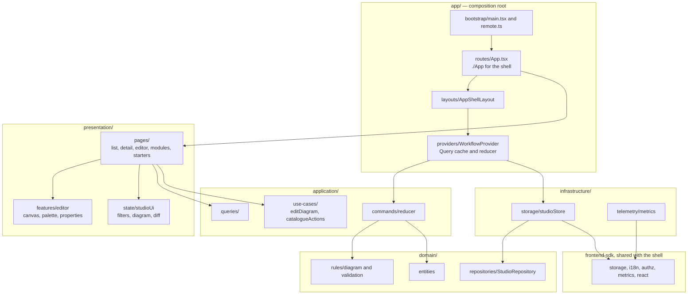

# Architecture

This document describes the internal structure, dependency direction, catalogue, federation contract, and deployment of `mfe-workflow-designer`.

`mfe-workflow-designer` is a **private Rsbuild remote** (`github.com/BCBP-SOLUTIONS-FZC-LLC/mfe-workflow-designer`, Node.js 22 in CI, Node 26 in the image builder, React 19). The npm package name is `mfe-workflow-designer` and `"private": true`. Nothing installs it. What ships is a Module Federation remote named **`workflows`** that exposes `./App`. The shell owns sign-in and mounts that module at `/t/:slug/workflows/*`. `@bcbp-solutions-fzc-llc/frontend-sdk` is a peer: the remote build takes the shell's copy, and the standalone page initializes it from `/config/runtime.json`. bpmn-js stays inside this bundle.

`package.json` `version` is `0.0.0`. No release tag exists yet. Image tags and the SemVer contract are in [VERSIONING.md](./VERSIONING.md). Decisions that depart from the constitution are in [docs/adr](./docs/adr/README.md).

| This remote owns | Lives elsewhere |
|---|---|
| Workflow list, detail, BPMN editor, module library, and starter gallery | Sign-in, tokens, and the shell routes (`web-shell`) |
| BPMN placement, publish rules, and the fixture catalogue | A workflow HTTP API. Persistence is SDK `storage('workflows')` |
| Connector secrets for the open page, held in memory | A credential vault. Secrets are omitted from BPMN and from storage |
| Tier 3 metric `portal_workflows_actions_total` | Platform and domain-shared metrics, and the OTLP export (the shell) |

---

## Layer model

`src/` follows the Frontend Architecture Constitution. Presentation calls application queries and use cases. Application calls domain rules. Infrastructure implements `StudioRepository`. `app/` is the composition root. `src/App.tsx` re-exports the route table so the remote expose path stays `./App`.

> Source: [`docs/architecture/mermaid/layer-model.mmd`](docs/architecture/mermaid/layer-model.mmd)



Screens do not import `domain/`. The application layer reads catalog sentences from `shared/copy`. Components use `useT`.

```
src/app/bootstrap                     standalone page and remote entry
src/app/routes/App.tsx                route table. src/App.tsx re-exports it
src/app/layouts                       chrome for this remote
src/app/providers                     catalogue provider
src/app/configuration                 catalog registration
src/presentation/pages                D1 list, D2 detail, D3 editor, D4 modules, D5 starters
src/presentation/features/editor      bpmn-js canvas, palette, properties
src/presentation/state                list, shell, gallery, editor, and diff UI
src/presentation/components           buttons, brand, theme picker
src/application/commands              catalogue reducer
src/application/queries               filters, labels, diff, assignment options
src/application/use-cases             palette edits, review, upload, export
src/domain/entities                   workflow, module, and starter models
src/domain/rules                      diagram XML and publish rules
src/domain/repositories               StudioRepository port
src/infrastructure/storage            SDK storage and the fixture seed
src/infrastructure/telemetry          portal_workflows_actions_total
src/shared                            app id and catalog lookup
```

## Catalogue and secrets

Publishing runs `validateWorkflow` on the diagram and the task records. Issues are catalog codes. The editor translates them.

Connector secrets live in the in-memory catalogue (`state.credentials`). `saveStudio` writes the catalogue without `credentials` and without the banner. A successful credential write deletes the in-page copy after it has been accepted. Export runs `assessExport` and records `export` on the metric. The downloaded BPMN does not contain the secret values.

`storage('workflows')` no-ops while the SDK namespace is anonymous. Standalone `npm run dev` is signed out, so a browser reload drops a workflow created in that session. A signed-in shell persists the catalogue for the workspace.

A workflow with `conflictArmed` refuses publish until `reload` replaces the draft with the server record. `lockedBy` makes the canvas read-only. Writes also require `update:tender` and a workspace that is not read-only (`useWorkflowAccess`). Theme preference uses the same storage helper and is saved only when the user picks a theme.

TanStack Query holds the catalogue ([ADR 0004](docs/adr/0004-server-state.md)). The query function reads `StudioRepository`. Notifications are synchronous so a banner paints in the same turn as the click. Zustand holds list filters, header search, the theme picker, the starter preview, the open module, the open diagram, and the version diff.

## Federation

| Item | Value |
|---|---|
| Remote name | `workflows` |
| Exposed module | `./App` from `src/App.tsx` |
| Container | `window.__platform_mfe_workflows` |
| Dev origin | `http://localhost:5005` |
| Shell route | `/t/:slug/workflows/*` |
| `ownerDomain` | `portal` |
| Shared singletons | `react`, `react-dom`, `@opentelemetry/api`, `frontend-sdk` (`import: false` on the remote build) |
| Bundled here | `bpmn-js`, the studio UI |

`rsbuild.config.ts` builds two environments into `dist/`. `remote` is the federated container. `standalone` bundles the SDK for `npm run dev`. HMR and live reload are off so `remoteEntry.js` stays a synchronous container.

## nginx paths

The production process is nginx on port **8080**, uid **101**.

| Path | Behavior |
|---|---|
| `GET /healthz` | `200` and the text `ok` |
| `GET /remoteEntry.js` | `no-cache`, readable cross-origin |
| Hashed `*.js` and `*.css` | `Cache-Control: public, max-age=31536000, immutable` |
| `GET /config/runtime.json` | `no-cache` |
| Extension-less paths | The standalone document |

## Observability

Finished studio actions increment `portal_workflows_actions_total` with labels `action` and `outcome`. Autosave, notice dismissal, and credential keystrokes are not counted. The inventory is [docs/observability/metrics.md](docs/observability/metrics.md). The shell exports the series. Standalone logs once when no manifest meter is available.
