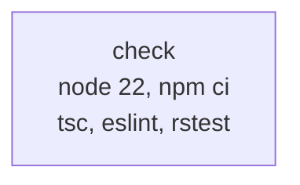

# Pipeline

How GitHub Actions checks `mfe-workflow-designer`. The workflow lives in [`.github/workflows/ci.yml`](../../.github/workflows/ci.yml).

One workflow file. It runs on a pull request and on a push to `main` or `master`.

| Workflow | When | What it decides |
|---|---|---|
| [`ci.yml`](../../.github/workflows/ci.yml) | Pull request or push to `main` or `master` | Typecheck, ESLint, Rstest |

Node on the job is **22**, matching `package.json` `engines`. The image builder is Node 26 (`Dockerfile`). Every `npm ci` reads `@bcbp-solutions-fzc-llc/*` from GitHub Packages with `GITHUB_TOKEN` (`packages: read`).

## Pull request and main



Source: [`mermaid/ci-flow.mmd`](mermaid/ci-flow.mmd).

| Job | Gate |
|---|---|
| `check` | `npm ci`, `npx tsc --noEmit`, `npm run lint`, `npm test` |

There is no coverage percentage gate, image scan, browser matrix, or tag-triggered release in this repository. Image build and CVE scanning stay with the platform pipeline that publishes remotes. The local pre-commit hook checks secret files, workflow hygiene, the Dockerfile digest pin, and `tsc --noEmit`. The test suite stays in CI. `changelog-check.yml` fails a pull request that changes the studio, its dependencies, or the image without updating `CHANGELOG.md`.

## Local equivalents

```bash
npm run hooks:install   # once per clone; again if .githooks/pre-commit changes
npm run typecheck
npm run lint
npm test
npm run build
```

`hooks:install` copies `.githooks/pre-commit` into `.git/hooks`. Git for Windows runs that hook with its Bash. The hook does not run ESLint or Rstest. Run those before a pull request.

Image checks need Docker and a GitHub Packages token:

```bash
docker build --secret id=npm_token,env=NODE_AUTH_TOKEN -t mfe-workflow-designer:local .
```

## Adding a check

| You want | Change |
|---|---|
| A new studio test | A file under `test/unit` or `test/e2e`. `npm test` already includes `test/**/*.test.ts` and `test/**/*.test.tsx` |
| A new commit-time rule | `.githooks/pre-commit`, then `npm run hooks:install` |
| A new CI step | A step on the `check` job in `ci.yml` |
